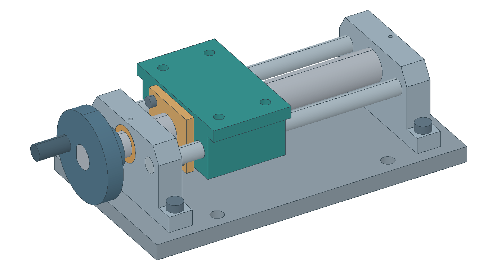

# 05 · FS40 双导杆手动丝杠滑台

> 给定装配示意、零件图和一批待验来料，完成一台行程 40 mm 的手动滑台。在指定环节分别用 GUI 和 API 建模，决定哪些原件可以放行，再交付能由手轮驱动的原生装配、法兰螺母零件图和总装工程图。

| 随题材料 | 考生完成的工作 |
| --- | --- |
| P02 端支座图、P03 滑鞍图 | 在 FreeCAD GUI 中从零绘制端支座；用 API 从零生成滑鞍，并验证孔群尺寸修改 |
| 两件中文规格 | 在 GUI 中画带 D 孔的手轮与阶梯摇柄销 |
| 四种有检验图的 STEP 来料 | 逐件量测、判定、说明影响，需要时修正。合格件也须有放行依据 |
| 法兰螺母模型、两种简化紧固件与装配示意 | 测绘螺母出零件图，完成 11 种 18 件的总装，验证运动、干涉及反转，再出总装工程图 |

**设计分级 L2／D3。** 工作目标、接口与验收量已给定，建模顺序和装配方式由考生决定。难点集中在多个部件对同一轴线、定位肩、油路和传动关系的共同约束，以及如何区分影响运动的错误与能装入的错件。首轮整卷由 GPT-6.2 Astra 完成、GPT-6.1 Sol 独立判卷，成绩 100/100。

内容范围参照机械类成图大赛中的读图建模、装配、纠错和二维出图。FS40 的机构、图样、名义模型和错件由本题原创，赛事题目的用时与评级须分别校准。[机械类先进成图赛道竞赛大纲](https://jxxy.hnie.edu.cn/16ctdsjsdg.pdf)

### 开考

向考生发放 [FS40 考生包](FS40-candidate.zip)，解压后打开任务书和七页图册。压缩包也包含 Windows FreeCAD GUI 工位。可在线查看[完整题面](candidate/任务书.md)与[装配示意及零件图](candidate/FS40-装配示意与零件图.pdf)。组织者将考生与考官资料分开，冻结交卷后交给另一个模型独立评分。

### 验收

[判卷细则](examiner/判卷.md)按六项分别计分。考官有可驱动的[参考总装](examiner/reference/assembly.FCStd)、两张制图参考、名义几何和检查脚本。出题人已经用 FreeCAD 1.1.0 重开参考装配，验证坐标、反转、来料正反例及只在零位摆对的反例。[验题读数](examiner/reference/验题读数.json)

本题在题库中编号为 05，图纸和模型使用滑台代号 FS40。首次试考的考生包 SHA-256 为 `5fdfc55bc47f690bc1f8b3e95863ad2d4f6426c51cdb5db88c59866226805b49`。[首次整卷盲试、实答与独立判卷](首次试考.md)
